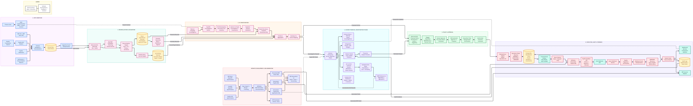

# Ask-Your-Payments: Autonomous FinOps Reconciliation Copilot

> **Team CrackerX · PayPal AI Hackathon 2026**  
> Dual-Custody Payment Reconciliation, Medallion Financial Architecture, and Autonomous Outbox Execution.

[](https://paypalaihackathon.devpost.com/)
[](https://www.ag-grid.com/)
[](https://www.apimatic.io/)
[](https://fastapi.tiangolo.com/)
[](https://www.docker.com/)
[](LICENSE)

---

## Executive Summary

Reconciling millions in B2B enterprise transactions across disparate ERP ledgers and payment gateways is prone to currency drift, fee discrepancies, and silent settlement drops. Manual ledger matching is slow, and unconstrained AI agents pose severe financial compliance risks.

**Ask-Your-Payments** solves this with an auditable, dual-custody FinOps engine:
1. **Explainable AI Investigation:** Translates natural language queries into restricted, allowlisted AST filters without direct execution privileges.
2. **Deterministic Dual-Custody (Maker-Checker):** Enforces separation of duties via PostgreSQL database constraints (`approver != proposer`).
3. **Resilient Transactional Outbox:** Guarantees idempotency and zero duplicate dispatches via background polling (`SELECT ... FOR UPDATE SKIP LOCKED`) and APIMatic-generated PayPal SDK execution.

---

## System Architecture

[](./architecture.png)
> *Click the diagram above to inspect the high-resolution architecture.*

The application implements a 6-stage operational pipeline:

1. **Data Ingestion (Bronze Layer):** Captures PayPal Sandbox events and ERP ledger records with cryptographic deduplication.
2. **Reconciliation & Double-Entry Accounting (Silver Layer):** Trigram string distance matching (`pg_trgm`), fee variance calculation, and currency-aware debit/credit journals.
3. **AI Financial Copilot:** Gemini 2.5 Flash processes queries into structured Pydantic schemas, isolated from direct database manipulation.
4. **Financial Studio (AG Grid Enterprise):** High-throughput Server-Side Row Model (SSRM), custom variance cell renderers, and real-time WebSocket state updates.
5. **Policy & Four-Eyes Governance:** Staged transaction payloads verified against tamper-evident payload hashes; self-approval strictly rejected at the database level.
6. **Execution & Audit (Outbox Worker):** Async worker claims approved payloads using `FOR UPDATE SKIP LOCKED` and executes settlements via the APIMatic PayPal SDK with collision-resistant `PayPal-Request-Id` headers.

---

## Sponsor Prize Implementation Matrix

Judges can inspect the exact code integrations below:

| Sponsor Focus | Implemented Capabilities | Direct Source Code Reference | Verification Method |
| :--- | :--- | :--- | :--- |
| **PayPal** | • Sandbox Order Settlement & Captures (`/v2/checkout/orders`)<br>• Idempotent execution using custom `PayPal-Request-Id`<br>• Real-time webhook ingestion & signature verification | `execution_worker.py:195-248`<br>`main.py:1883-1892` | Live worker terminal outputs `[INBOUND HTTP TRACE] HTTP/1.1 201 Created` from `api-m.sandbox.paypal.com` |
| **AG Grid** | • Server-Side Row Model (SSRM) infinite scrolling<br>• Copilot AST dynamic filter injection (`compiled_intent`)<br>• Autonomous Manager Inbox (`setFilterModel({ erp_status: ['PENDING_APPROVAL'] })`) | `frontend/app/page.tsx:428-447`<br>`frontend/app/page.tsx:1908-2007` | Changing active role to `Senior Manager` immediately triggers SSRM purge and filters ledger to pending rows |
| **APIMatic** | • Pre-compiled Python SDK generated from PayPal ERP schema<br>• Strict type contracts for financial payloads<br>• Production-grade client integration in background worker | `paypal_erp_sdk/sdk/python`<br>`requirements.txt`<br>`execution_worker.py:40-65` | SDK compiled in Docker stage; imported directly by backend execution worker |

---

## Quickstart (Single-Command Docker Stack)

Run the entire multi-service stack with one command.

### Prerequisites
- Docker Desktop (with Compose V2 enabled)
- Git

### 1. Clone & Configure Secrets
```bash
git clone https://github.com/ayush-agre/ask-your-payments.git
cd ask-your-payments
cp .env.example .env
```

### 2. Launch Entire Stack
```bash
docker-compose up --build -d
```

### 3. Access Services
- **Financial Investigation Studio (Frontend):** [http://localhost:3000](http://localhost:3000)
- **FastAPI Core & OpenAPI Docs:** [http://localhost:8000/docs](http://localhost:8000/docs)
- **Readiness & Liveness Probe:** [http://localhost:8000/healthz](http://localhost:8000/healthz)

### 4. Automated Architecture Verification
Run the end-to-end verification suite:
```bash
python verify_e2e.py --url http://localhost:8000
```
